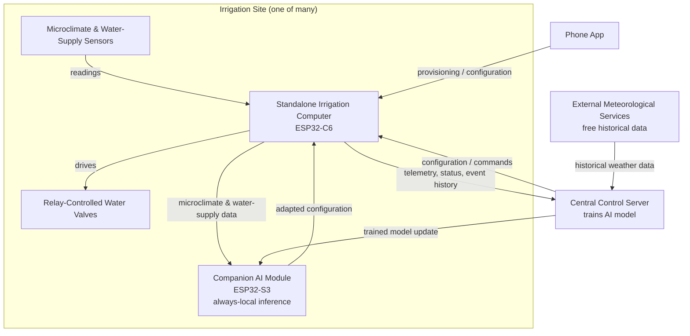
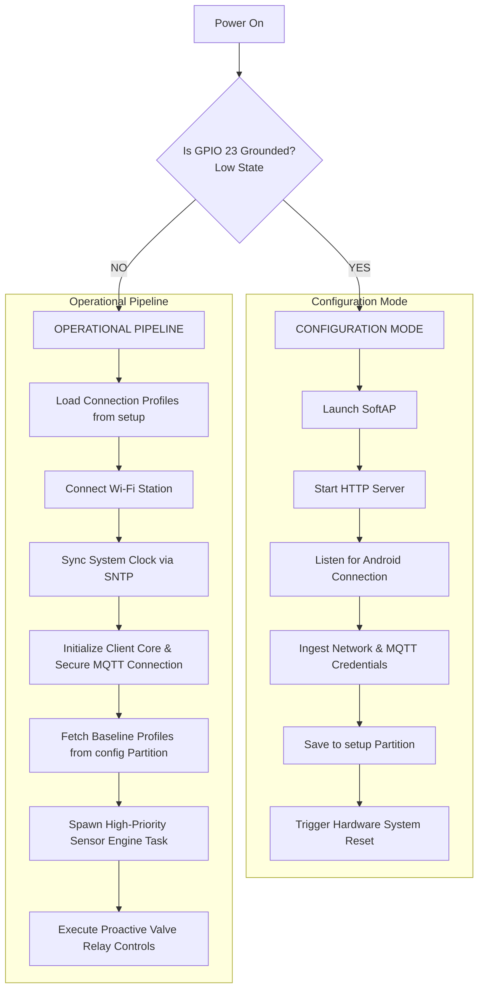

# Smart Irrigate — High-Level Design 

---
* Project state: ***construction & sandbox***
 
## Table of Contents

* [Project Description](#project-description)
  * [System Tiers](#system-tiers)
  * [Setup & Operational Mode](#setup--operational-mode)
* [High-Level Operational Logic Diagram](#high-level-operational-logic-diagram)
* [Core Concepts & Operational Logic](#core-concepts--operational-logic)
  * [Predictive & Macro-Environmental Irrigation Control](#predictive--macro-environmental-irrigation-control)
  * [Hydraulic Feedback & Healing (Zero-Pressure Handling)](#hydraulic-feedback--healing-zero-pressure-handling)
  * [Multi-Valve Scheduling & Compile-Time Constraints](#multi-valve-scheduling--compile-time-constraints)
* [Power Architecture](doc/PowerArchitecture.md)
  * [Power paths](doc/PowerArchitecture.md#power-paths)
  * [Behaviour by state](doc/PowerArchitecture.md#behaviour-by-state)
  * [Parts and where they are used](doc/PowerArchitecture.md#parts-and-where-they-are-used)
  * [Estimated power (battery side)](doc/PowerArchitecture.md#estimated-power-battery-side)
  * [Open decisions](doc/PowerArchitecture.md#open-decisions)
* [Physical Placement: Separate Enclosures](doc/PhysicalPlacement.md)
  * [Connection overview](doc/PhysicalPlacement.md#connection-overview)
* [Project Progress Plan](doc/ProjectProgressPlan.md)
* [Heat and Environment](doc/HeatAndEnvironment.md)
* [Building from Scratch](doc/BuildingFromScratch.md)
  * [Build dependencies](doc/BuildingFromScratch.md#build-dependencies)
  * [Steps after a fresh clone](doc/BuildingFromScratch.md#steps-after-a-fresh-clone)
  * [Troubleshooting a fresh build](doc/BuildingFromScratch.md#troubleshooting-a-fresh-build)
* [Project Configuration](doc/ProjectConfiguration.md)
  * [Hardware Pin Configurations](doc/ProjectConfiguration.md#hardware-pin-configurations)
  * [Network & Protocol Configurations](doc/ProjectConfiguration.md#network--protocol-configurations)
  * [Storage & Partition Layout Architecture](doc/ProjectConfiguration.md#storage--partition-layout-architecture)

## Project Description
**Smart Irrigate** is an automated, low-power irrigation controller engineered for the **ESP-IDF 6.0 framework** running on the ESP32-C6 FireBeetle 2 platform. The device acts as an intelligent edge-computing node that monitors microclimate variables, tracks live hydraulic line pressure data, and manages a matrix of physical AC water valves using an external relay array.

### System Tiers
Smart Irrigate is designed to operate as a three-tier system, from a fully autonomous single unit up to a fleet managed by a central control server:
* **Standalone Irrigation Computer:** The ESP32-C6 unit described above can run entirely on its own. It accepts a configuration (valve schedules, environmental baselines, thresholds) pushed from a phone app during provisioning or from a server over MQTT, and independently drives the valve relays according to that configuration and its own sensor readings — no continuous connection to a backend is required for it to keep irrigating correctly.
* **Companion AI Module (ESP32-S3):** A second, chained ESP32-S3 module collects the microclimate and water-supply data streamed by the irrigation computer and runs local AI/ML inference to adapt the irrigation configuration to observed and forecast weather conditions. Inference always runs standalone on the ESP32-S3 itself — it does not require the central server to function. The model it runs, however, is trained offline on an external server, using telemetry collected from the station together with free historical data pulled from existing meteorological services; the trained model is then pushed down to the ESP32-S3 for local inference.
* **Central Control Server:** A backend service capable of managing a fleet of many standalone irrigation computers simultaneously. It ingests each unit's microclimate telemetry, status, and irrigation event history over MQTT, and can push updated configurations to any unit. It also coordinates with each unit's companion AI module, updating the AI's plan when broader, cross-site or historical data (e.g. regional weather trends) warrants a change beyond what the local AI module alone would decide.
  * It is possible to use only a single device with central control server. 

   
### Setup & Operational Mode 
The software architecture leverages ESP-IDF 6.0 optimizations—such as the memory-efficient **Picolibc standard library**—to run proactive edge-logic routines. Smart Irrigate transitions between two software-controlled lifecycles evaluated at boot time:
* **Setup Mode:** Triggered manually by holding down a physical button interface during boot. The device suspends monitoring and spins up a native local Wi-Fi Access Point (SoftAP) alongside an **HTTP server** (`esp_http_server`). A dedicated Android app connects directly to this host network, exchanging structured string payloads to populate network credentials and MQTT infrastructure layouts. The HTTP server parses these properties, commits them into a dedicated Non-Volatile Storage (NVS) communication partition, and issues a hardware system restart.
* **Operational Mode:** The standard execution pathway. The device extracts connection profiles from the communication NVS partition, connects to the network via Wi-Fi Station mode, updates its clock via SNTP, and establishes a persistent, secure session with an upstream MQTT broker. A real-time engine concurrently samples physical data from the sensor array, packages the values, and streams them to the broker. Concurrently, the system acts upon incoming remote valve command structures, logging execution timelines and tracking irrigation events in real time.

## High-Level Operational Logic Diagram

## Core Concepts & Operational Logic

### Predictive & Macro-Environmental Irrigation Control
Smart Irrigate explicitly avoids relying on a high density of localized ground moisture probes. Because ground sensors only reflect moisture in a very localized, narrow radius, they fail to account for the broader macro-environmental variables driving true plant transpiration and soil evaporation. Instead, this system utilizes an advanced atmospheric and thermal tracking approach to calculate total water demand:
* **Evapotranspiration & Microclimate Analysis:** Rather than measuring stagnant ground moisture, the device continuously samples ambient air temperature, relative humidity (via the SHT41), and barometric pressure (via the BMP581). By combining these real-time data streams, the system monitors the vapor pressure deficit (VPD) and thermal conditions that directly influence how fast plants lose water and how quickly the ground dries up.
* **Solar Load Quantification:** To prevent identical watering behaviors on overcast versus clear days, the system utilizes a solar panel on the sensor cluster to measure the sunlight level. This real-time solar irradiance data allows the edge logic to accurately model solar energy accumulation across the landscape zone.
* **Thermal Inertia & Soil Mass Tracking:** A ruggedized, single-point digital thermometer (DS18B20) is deployed just below the topsoil layer. This serves as a thermal anchor, tracking core soil temperature trends against rapid shifts in air temperature to accurately determine evaporation behavior influenced by soil thermal mass.
* **Boundary Layer Wind Dynamics (Active Analog Processing):** To account for wind stripping away the humid air layer around leaves and increasing plant water loss, the system actively processes live wind speed metrics. An analog wind sensor continuously tracks ambient velocities up to 30 meters per second with a high-accuracy resolution of 0.1 meters per second. The edge logic combines this velocity data with local temperature and humidity readings, automatically increasing watering durations during windy periods to compensate for faster soil drying.
* **Barometric Weather Prediction & Seasonal Inflection Tracking:** The system monitors short-term barometric pressure tendencies using the BMP581 to anticipate regional rain fronts, adjusting upcoming irrigation volumes dynamically. On a macro-scale, the device cross-references its real-time atmospheric tracking with historical trends sent via the MQTT broker to map seasonal inflections (e.g., changes in solar intensity, regional winds, and seasonal dry spells). This atmospheric data profile allows the system to accurately predict landscape water depletion across the entire zone without deploying numerous spot-checking ground probes.
* **Environmental Compensation (Adaptive Volume):** The system evaluates live atmospheric metrics against the baseline parameters received in the MQTT configuration profile. If measured air temperature or solar load exceeds, or relative humidity drops significantly below the expected thresholds, the edge logic dynamically increases or decreases the calculated watering duration to compensate for altered soil evaporation rates.

### Hydraulic Feedback & Healing (Zero-Pressure Handling)
* If the system opens a relay to actuate a valve but the XDB401 transmitter reports a **"No Water Pressure"** state (indicating a dry main line, pump failure, or supply cutoff), the controller proactively shuts down the valve to protect hardware and avoid dry cycling.
* It logs a specific fault event to the MQTT tracking server.
* The system then automatically defers the irrigation cycle, constantly or periodically polling the line until water pressure is detected again, at which point it safely resumes the deferred watering routine later on.

### Multi-Valve Scheduling & Compile-Time Constraints
The device natively manages a matrix of **8 independent physical water valves** (one per channel of the 8-channel relay board), each governed by its own independent logic pathway:
* **Independent Water Events:** The system tracks up to **6 distinct optional water events per valve** (totaling up to 48 distinct schedulable runtime blocks across the device). Each event is evaluated against incoming MQTT operational profiles and adjusted by the macro-environmental compensation engine.
* **Compile-Time Hardware Constraints:** Because the hardware layout binds each independent valve relay to a dedicated physical microcontroller pin, the GPIO mapping is rigidly locked into the project's compilation layer using **ESP-IDF Kconfig (`Kconfig.projbuild`)**. Modifying or shifting these pin allocations requires rebuilding the firmware via the build system, safeguarding the running application from runtime pin conflicts or accidental software rewires.

---

## Sensors

| Name / code | Description |
|---|---|
| BMP581 | Barometric pressure and temperature, for rain-front prediction. |
| SHT41 | Ambient air temperature and relative humidity, for vapor pressure deficit. |
| Solar panel | Sunlight level, for solar load. On the sensor cluster. |
| DS18B20 | Soil temperature 5-10 cm deep, for soil thermal mass tracking. |
| XDB401 | Water line pressure, for no-water detection. |
| Analog wind sensor (0-5 V) | Wind speed from 0 to 30 m/s. |
