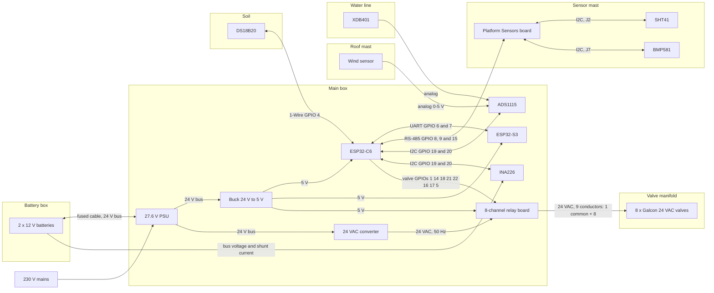

# Physical Placement: Separate Enclosures

[← Back to the main README](../README.md)

The components do not share one box. Placement is decided by what each part can survive outdoors (heat, rain, cold), and by what it needs to measure correctly. Parts that are not weatherproof go in a protected box, parts that must be outside to measure correctly get their own housing, and parts that are weatherproof as bought are mounted outside with no box.

| Box | Contents | Location | Housing and notes |
|---|---|---|---|
| **Main box** | Mainboard (ESP32-C6, ESP32-S3), 8-channel relay board, 27.6 V PSU, buck converter to 5 V, 24 VAC converter, fuses | Indoors or a sheltered spot | Sealed. 230 V side kept apart from the low-voltage side. |
| **Battery box** | 2 x 12 V batteries (series) | Next to the main box | Vented to open air, shaded and cool. Short fused cable to the main box through a gland. Lead-acid gives off hydrogen when charging, so keep it out of the main box. |
| **Sensor mast** | Platform Sensors board, SHT41 and BMP581 (ventilated radiation shield) | Outdoors, at least 1 m above the roof, clear sky view | Housings at least 30 cm apart. SHT41 and BMP581 each on a short I2C cable to the Platform Sensors board (J2, J7), which talks to the main box over RS-485. SHT41 in shade with free airflow. |
| **Roof mast (no box)** | Wind sensor | Roof, 1-2 m above the ridge, clear of the other housings | Weatherproof as bought. Pole mounted, level, with a drip loop in the cable. |
| **Soil (no box)** | DS18B20 | Irrigated zone, 5-10 cm deep | Waterproof probe in a sealed sleeve. Strain relief at the surface. |
| **Water line (no box)** | XDB401 | Tee near the manifold | Threaded fitting, upright or sideways. Add an isolation valve. |

## Connection overview

The 24 V bus carries power from the PSU to the battery, and from the battery to the loads during an outage (see "Power Architecture"). The relay board switches the 24 VAC from the converter to each valve.
