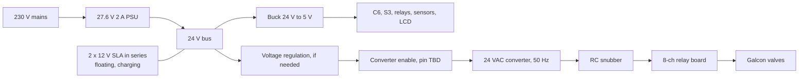
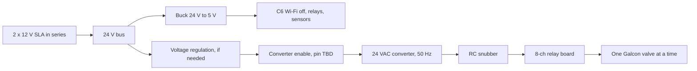

# Power Architecture

[← Back to the main README](../README.md)

> **Status: design under evaluation.** Nothing here is built yet. Power figures are datasheet-typical estimates, not measurements. Items marked **TBD** are open decisions.

The valves are **24 VAC Galcon solenoids** (0.30 A inrush, 0.19 A holding, ~2.1 W real power, 7.2 VA inrush / 4.6 VA holding). They must keep watering when mains is lost, so the whole system runs from a single **24 V DC bus** that a mains PSU feeds and a battery backs up. A DC-to-AC converter (part not selected yet) turns the bus into the 50 Hz 24 VAC the valves need. No 230 V-to-24 V transformer and no 230 V inverter is used.

## Power paths

**Mains present (non-battery state)**

**Battery (mains lost)**

The battery floats across the bus at all times, so a mains loss causes no switch-over: the loads simply keep drawing from the battery.

## Behaviour by state

| | Mains present | Battery |
|---|---|---|
| Wi-Fi / SNTP / MQTT | On | **Off** (local schedule from the `config` partition, RTC clock) |
| ESP32-S3 companion | On | **Off** |
| Valves open at once | set by `DEVICE_MAX_SIMULTANEOUS_OPEN_VALVES` (menuconfig under "Main Power ON", default 2, range 2-16; design range 2-4), starts staggered ~0.5 s | **1**, time-sliced round robin: each valve gets a slice of at most `DEVICE_MAX_ROUND_ROBIN_TIME_MINI` minutes (menuconfig under "Main Battery ON", default 10, range 5-30), then the next valve with remaining time, until all counters reach zero |
| Valve switch order | Close old, wait ~1 s, open next (one-valve mode) | Same |
| LCD2004 (driven by the ESP32-S3) | Wakes on button, off after N minutes | **Off** (the S3 is off) |
| Status LED (`LED_Pin`) | Startup errors only | Startup errors only |
| Battery indicator | Off | Slow-blink LED (pin **TBD**) |
| 24 VAC converter | Enabled only while a valve is open | Enabled only while a valve is open |

## Parts and where they are used

| Part | Role | Mains | Battery |
|---|---|---|---|
| FireBeetle 2 ESP32-C6 | Main controller | Yes | Yes (Wi-Fi off) |
| ESP32-S3 DevKitC-1 | Companion AI module | Yes | **No** |
| 8-channel 5 V relay module (off-board, on mainboard header J15) | Valve switching, all 8 channels used (IN1-IN8 = valves 1-8) | Yes | Yes |
| 2 x SN74AHCT125N quad buffer (U10, U11), 100 nF each | Buffers the 8 valve GPIOs from 3.3 V to 5 V logic for the relay inputs. Powered from the 5 V net, `/OE` tied to GND | Yes | Yes |
| 8 x Galcon 24 VAC solenoid valves | Water valves | Yes | Yes (1 at a time) |
| 230 V to 27.6 V, 2 A PSU | Feeds the bus, charges the battery | Yes | **No** (absent) |
| 2 x 12 V SLA battery in series | Backup (24 V) | Yes (floating) | Yes (sole source) |
| Battery fuse and low-voltage disconnect (~21 V) | Protection | Yes | Yes |
| Buck converter 24 V to 5 V (35 V rated) | Logic supply | Yes | Yes |
| Voltage regulation stage (needed only if the converter output follows its input) | Holds valve voltage at 24 Vrms from the 27.6 V bus | Yes | Yes (bus <= 25.6 V; must not drop below ~21 Vrms at the valves) |
| 24 VAC converter (DC-to-AC, part not selected) | Makes 50 Hz 24 VAC for the valves. Requirements: input range covers the 21-27.6 V bus, 24 Vrms output, 1 A continuous (4 valves holding), 2 A peak (inrush), enable input or switchable supply, short-circuit protection | Yes | Yes |
| RC snubber (~0.1 uF + 47-100 ohm), shared | Edge softening, relay contact protection | Yes | Yes |
| Fuses (converter input, 24 V side) | Protection | Yes | Yes |
| F3, 5 A fuse in a 5x20 mm panel-mount PCB holder (6 A, 250 V rated) on the 24 V DC input J1 | Protects the board and a reversed supply (the 30 V TVS conducts and blows the fuse) | Yes | **No** (absent) |
| Mains detect (no extra part, firmware reads the INA226 bus voltage and applies a threshold) | Selects the mode | Yes | Yes |
| ADS1115 (I2C, 16-bit ADC) | Reads line pressure (AIN0), wind speed (AIN1) and board temperature (AIN2) | Yes | Yes |
| INA226 (I2C 0x40) with a 10 mohm shunt in the battery negative lead | Battery bus voltage and battery current (coulomb counting), low-battery warning | Yes | Yes |
| TCA9555 (I2C 0x20, 16-bit I/O expander) | Status LEDs, battery-state LED (P07), SHOW LEDs button, 24 VAC converter enable (P12), ESP32-S3 power enable (P13), buzzer (P14) | Yes | Yes |
| ESP32-S3 power switch: Q1 AO3401A (P-FET) driven by Q2 BSS138, R34 and R35 100k | Cuts the 5 V feed of the ESP32-S3, the LCD and the level shifter U9. On by default, off when U5 P13 is pulled low | Yes | Yes |
| Buzzer BZ1 (active 5 V, with oscillator), driver Q3 BSS138, flyback diode D8 | Audible alarm, switched by U5 P14 | Yes | Yes |
| BMP581, SHT41 (I2C) | Weather sensors | Yes | Yes |
| DS18B20 (1-Wire) | Soil temperature | Yes | Yes |
| MCP9700A U7 (TO-92, on the main board, analog) | Board temperature, 10 mV/degC output (500 mV at 0 degC) read by ADS1115 AIN2 | Yes | Yes |
| XDB401 pressure transmitter | Line pressure and no-water check | Yes | Yes |
| Wind sensor (0-5 V) | Wind speed | Yes | Yes |
| LCD2004 with I2C backpack (5 V module) | Local display, driven by the ESP32-S3 (its own I2C bus, not the C6 sensor bus). Powered from the 5 V net, the same net as the S3 5 V input, so it follows the S3 supply | Yes (on request) | **No** |
| BSS138 I2C level shifter U9 | Lets the 3.3 V S3 I2C lines (GPIO 8 and 9) talk to the 5 V LCD backpack, whose pull-ups are tied to 5 V | Yes | No |
| LCD wake button | Display control, on an ESP32-S3 GPIO | Yes | No |
| Status LED (`LED_Pin`) | Startup error indicator | Yes | Yes (errors only) |
| Battery-state LED (slow blink) | Shows battery mode | No | Yes |
| Config switch (GPIO 23) | Boot into Configuration Mode | Boot only | **Ignored** |

**Not used in either path:** a 230 V to 24 VAC transformer, a 12 V to 230 V inverter, a mains/inverter changeover relay, a series DC-blocking capacitor, and the FireBeetle's own Li-ion charger (it only handles a single 3.7 V cell).

## Estimated power (battery side)

| State | Draw |
|---|---|
| Battery idle (Wi-Fi off, LCD off, converter off) | ~0.4 W |
| Battery, one valve open | ~3-4 W (valve ~2.1 W plus converter and relay losses) |
| Mains, 2-4 valves open, electronics on | PSU needs ~2 A at 27.6 V including recharge |

Battery sizing for 12 h idle plus 3 h of one valve is about 13 Wh usable, so two 12 V 4 Ah batteries in series leave generous margin.

## Open decisions
* **TBD:** how the 24 VAC converter regulates the valve voltage (built into the converter, or a separate stage).
* **TBD:** select the 24 VAC converter. It must produce an acceptable waveform and voltage for the Galcon valves (run cool and quiet) and have an enable control. A square wave is acceptable if the valves tolerate it; otherwise use a sine-modulated H-bridge on a 36-42 V bus, or a 12 V sine inverter feeding a 24 V transformer.
* Inputs and outputs for the mains-detect, battery sense, battery LED, 24 VAC converter enable, ESP32-S3 power enable and buzzer are decided: see the TCA9555 row above (the LCD has moved to the ESP32-S3, which is off on battery, so it no longer needs C6 pins). With 8 valves every safe GPIO on the FireBeetle 2 header is used (1, 4, 5, 6, 7, 14, 15, 16, 17, 18, 19, 20, 21, 22, 23, with 2 and 3 still free; 8 and 9 are boot-strapping pins, used only for the RS-485 RX and TX), so these use the TCA9555 I/O expander (U5, I2C 0x20) on the existing I2C bus. Battery sense needs no pin: the INA226 reads it over I2C. The RS-485 DE is on GPIO 15, and GPIO 2 and 3 are unused.
