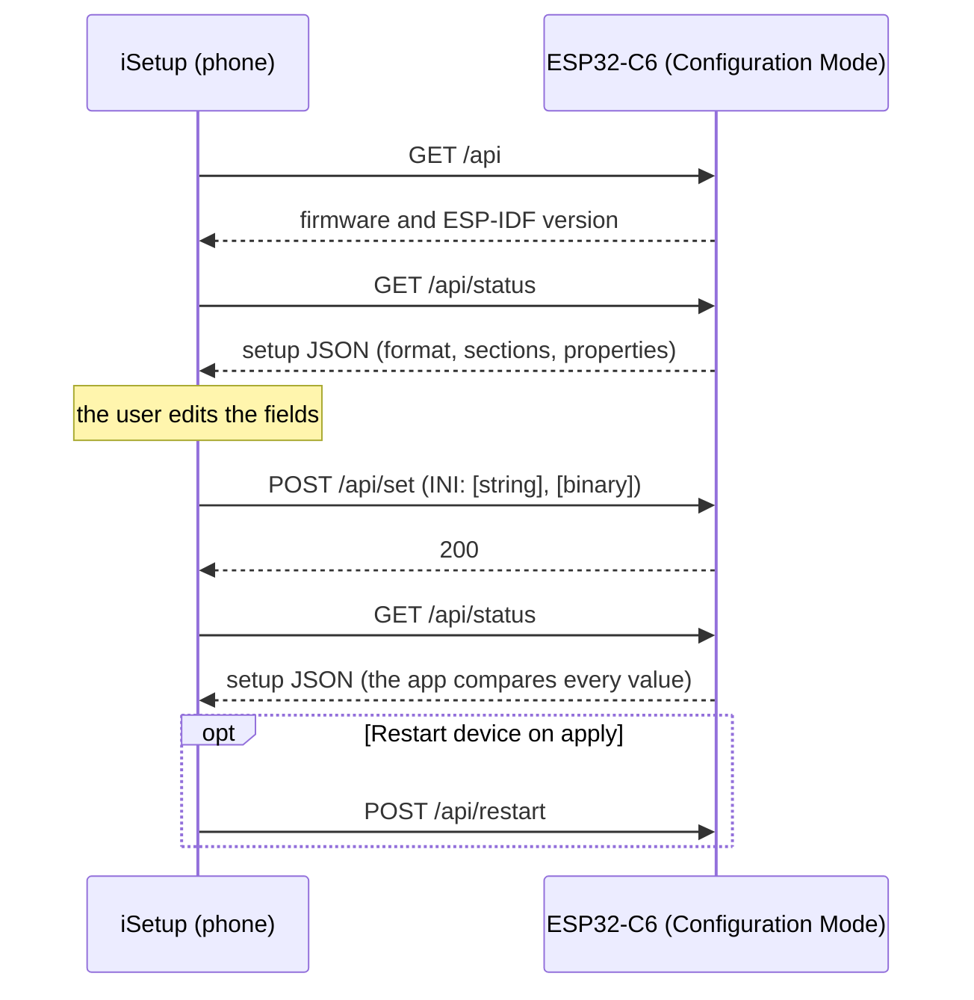
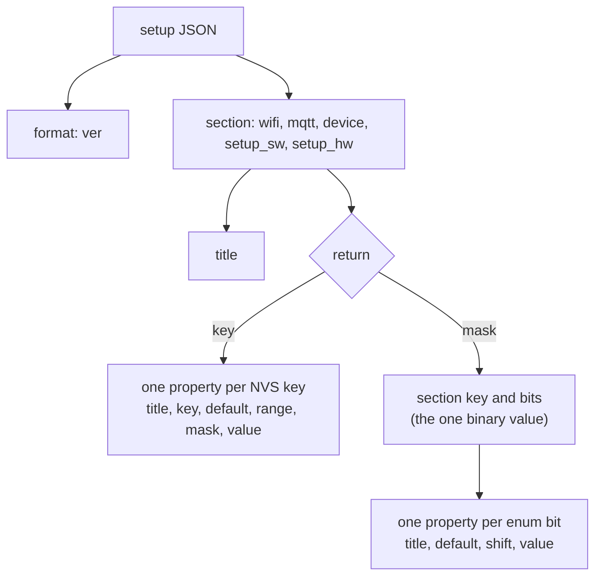
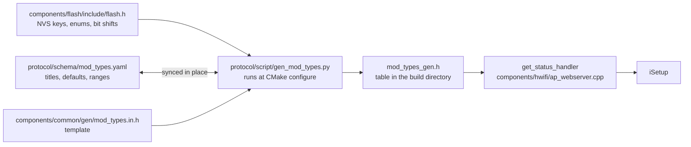
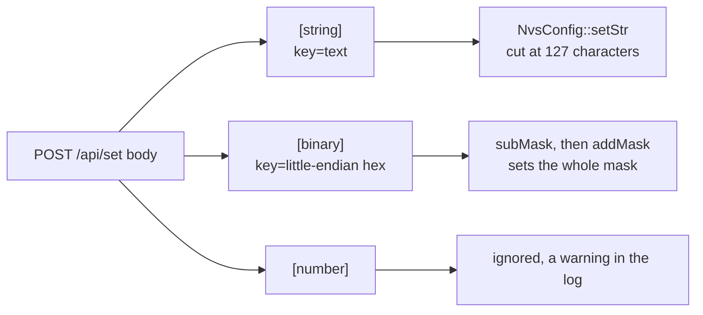

# Irrigate iSetup
* Code build by ClodeCode

Android companion app for the Smart Irrigate controller. When the device is in
Configuration Mode it starts a SoftAP + local HTTP API; iSetup connects to that AP and
talks to the API to read and push the setup values (Wi-Fi, MQTT, device, and the software and
hardware enable masks), without needing the device on your normal network yet.

## What it does

- On launch, silently probes the device (`GET /api/status`) and, if reachable, loads the setup
  JSON: the device declares what the app may modify, the app does not hard-code any key. Fields are
  grouped under the section titles the device sends.
- A text property respects its `range` (the maximum length) and shows dots when it is `mask`ed
  (passwords). A bit property (hardware / software enable) is a switch. A property the device does
  not store yet has no `value`, so the app shows its `default`.
- Lets you edit the fields and push **all** values back with `POST /api/set` (an INI body, see
  below), then re-fetches and verifies the device accepted each value. Fields changed since the
  last load are shown in yellow.
- Optionally restarts the device (`POST /api/restart`) after a successful apply. The enable masks are
  read once at boot, so a change needs the restart.
- Also fetches static device details (`GET /api`, e.g. firmware/esp-idf version) on launch and shows
  them read-only in an **About** dialog, reachable from the top bar's overflow (⋮) menu — which is
  also where a **Settings** entry will live once there's device-wide configuration to expose.

## Talking to the device

`DeviceApi` (`app/src/main/java/org/magicat/irrigate/connect/network/DeviceApi.kt`) is the only
place that makes HTTP calls, against a base URL built from `BuildConfig.DEVICE_HOST` /
`DEVICE_PORT`:

| Call | Method | Endpoint | Purpose |
|---|---|---|---|
| `fetchInfo` | GET | `/api` | Static device details (read-only) |
| `fetchStatus` | GET | `/api/status` | The setup JSON: what may be modified, with the current values |
| `pushStatus` | POST | `/api/set` | Apply the values (INI body) |
| `restartDevice` | POST | `/api/restart` | Reboot the device |



Default target is the device's SoftAP gateway (`192.168.3.1:80`, see `DEVICE_HOST`/`DEVICE_PORT` in
`app/build.gradle.kts`) — connect your phone to the device's AP before using the app, or change
those build config fields to point at a device already on your LAN.

`GET /api` is the exception to the setup JSON: it still answers `key=value` pairs inside `{}`
rather than standard `key:value`. `org.json.JSONObject`'s tokenizer accepts `=` as a colon
substitute, so it parses as-is — don't "fix" it to `:` without also changing the firmware side
(`get_version_handler` in `components/hwifi/ap_webserver.cpp`).

## The setup JSON (`GET /api/status`)

The format is defined by `components/protocol/schema/mod_types.schema.json`, with a sample in
`components/protocol/schema/mod_types.exampe.json`. `format.ver` is the revision of the layout; the
app refuses a version it does not know.



* The type of a property is the type of its `default` (string or boolean for now).
* `return: key` (the default): every property is stored under its own NVS `key`.
* `return: mask`: the properties are bits of one value stored under the section `key`. `bits` is the
  width of that value; it is returned in the next fitting width (12 bits is returned as 16).

### Where the device gets it

The device does not hold the JSON as text. `get_status_handler` streams it in chunks from a
`constexpr` table that is generated at build time, so no buffer holds the whole document.



A new key or enum entry in `flash.h` is added to the YAML (with a title derived from its name) the
next time CMake configures, and an entry that is gone from `flash.h` is removed. Edit the YAML to
give it a real title or range.

## The apply body (`POST /api/set`)

An INI-style `text/plain` body, built by `toBody()` in `ConfigValue.kt`. Section names are lower
case. The app sends every value, not only the changed ones.

```
[string]
wifi_ssid=home
wifi_password=ddjhdfsjhk
[binary]
enable_softw=0100
enable_hardw=44040000
```



* `[string]`: `key=value` text lines. Any other header, or none, is also a string section.
* `[binary]`: one line per `return: mask` section. The value is the combined bits as little-endian
  hex, 4 digits for up to 16 bits and 8 digits for up to 32 bits.
* `[number]`: accepted by the device but not supported yet, so its lines are ignored with a warning.
* The app limits a text field to its `range` maximum (64 now). The device cuts any string at 127
  characters, the size of its read buffer.

## Planned

iSetup will also send configuration to the C6 (the structures described in `../../doc/stractures.md`).
This is not implemented, and the app is expected to grow more complex when it is.

## Build

Standard Gradle/AGP project, no ESP-IDF toolchain needed:

```bash
./gradlew assembleDebug
# or, connected device/emulator:
./gradlew installDebug
```

Requires `compileSdk`/`targetSdk` 37, `minSdk` 30 (see `app/build.gradle.kts`).

## Project layout

```
app/src/main/java/org/magicat/irrigate/connect/
├── MainActivity.kt        # Compose UI: connect/refresh, sections and settings, About dialog
├── model/ConfigValue.kt   # setup JSON -> Section / Property, toBody() (INI body), About fields
├── network/DeviceApi.kt   # HTTP client for the device's setup API
└── ui/theme/              # Compose theme
```

## Open items

* The app has not been compiled since the setup JSON change: the dev machine has no Android SDK.
  Build it in Android Studio first.
* `[number]` values are not sent or stored yet.
* `toIniString()` in `ConfigValue.kt` is the old flat format and is no longer used.
